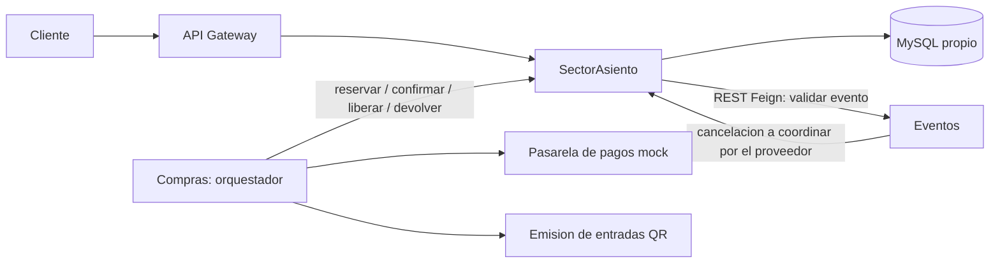
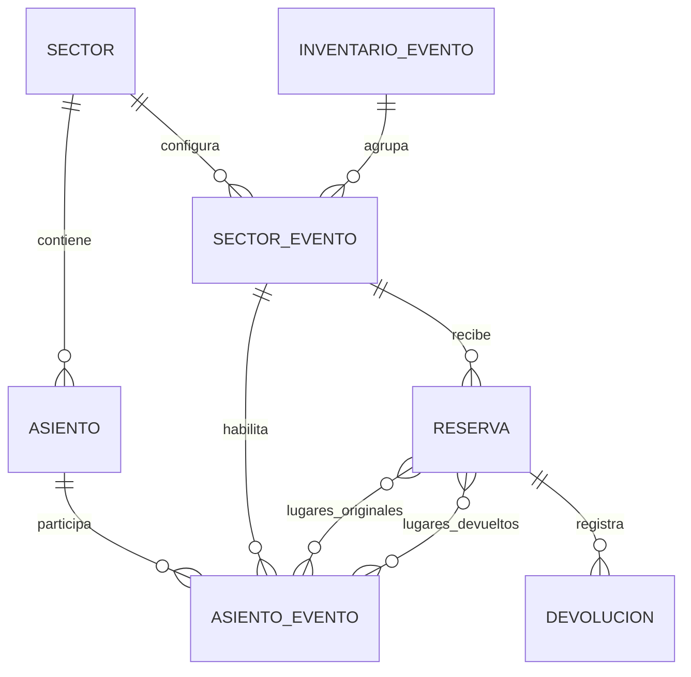
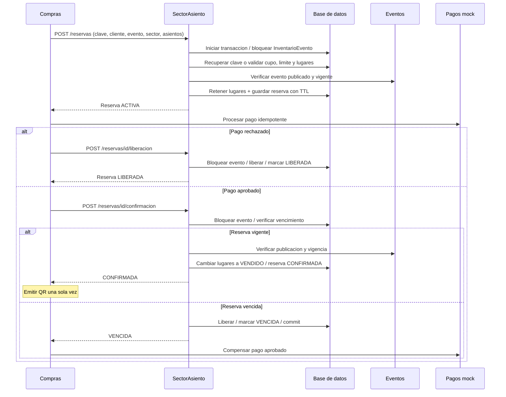

# Diseno del inventario

## Modulos y responsabilidades

El gateway y las rutas de inventario estan implementados. Los proveedores Eventos y Compras todavia deben implementar y acordar sus contratos. No se comparten entidades JPA entre servicios: idLugar, idCliente e idEvento son referencias externas. EventoInventario replica lugar/fecha del proveedor para coordinar su inventario; Eventos sigue siendo la fuente de verdad y se consulta por Feign antes de vender/confirmar y al devolver.

## Modelo local

La relacion entre InventarioEvento y SectorEvento se mantiene por idEvento en el servicio; no hay una relacion JPA adicional. Las tablas de union conservan los lugares originales y devueltos. Se impone unicidad por sector/fila/columna y por configuracion/asiento. La reserva captura el precio para que una compra no cambie de importe por modificaciones posteriores. Los contadores de campo y de sectores numerados se actualizan junto con la reserva; para numerados se actualizan tambien sus posiciones.

## Secuencia de compra numerada

Ante timeout en confirmacion, Compras debe consultar la reserva antes de compensar: el commit pudo haberse completado aunque se perdiera la respuesta. Tanto confirmar como liberar soportan reintentos. La idempotencia de cobro y emision de QR pertenece a Compras; esta implementacion garantiza la parte de inventario.

## Cancelaciones y devoluciones

Una devolucion aprobada libera solo los asientos/cantidad no devueltos previamente y registra su clave. Una cancelacion bloquea el evento, libera pendientes y marca el inventario cancelado en la misma transaccion. Repetirla no cambia los contadores. No se realiza el reintegro monetario en esa transaccion: el proveedor Compras debe gestionarlo con reintentos y su propia trazabilidad.

Las pruebas ejecutadas cubren transacciones independientes con conexiones a H2, incluso en concurrencia; no lanzan distintas JVM ni comprueban MySQL. La base descartable de MySQL y los comandos estan en README.md para completar esa verificacion con Docker disponible.
