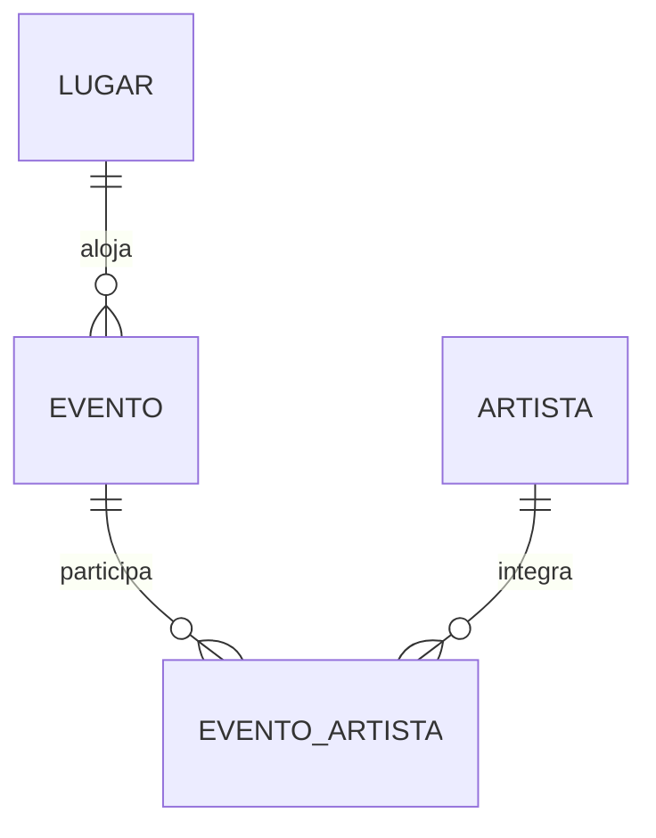
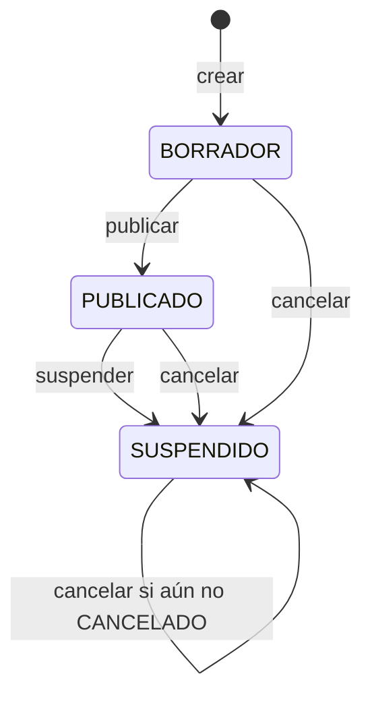

# Modelo y responsabilidades de Eventos

Eventos administra el catálogo de eventos y sus lugares/artistas. La disponibilidad, los precios por sector, las reservas y la venta de lugares pertenecen a SectorAsiento y Compras. No se comparten entidades JPA entre microservicios.

Evento guarda ID, nombre, descripción, tipo, idOrganizador externo, fechaHora, lugar, estado, estadoPublicacion y demanda. La tabla evento_artista relaciona eventos con artistas. Lugar contiene dirección, ciudad, coordenadas y tipo. Artista contiene nombre y género. Los IDs y asociaciones son locales a la base eventos; idOrganizador referencia a Usuarios sin FK entre bases.

Este diagrama representa estadoPublicacion. La cancelación además asigna estado=CANCELADO. Publicar y suspender no cambian estado, que inicia EN_CURSO. No se implementó republicación desde SUSPENDIDO. AGOTADO y FINALIZADO existen en el enum, pero los endpoints actuales no exponen una transición específica hacia ellos.

Las búsquedas aplican filtros solo a eventos PUBLICADO. Las listas generales y las consultas por ID incluyen borradores y suspendidos. El contrato se encuentra en static/openapi.json; las limitaciones observadas están en REST.md.
